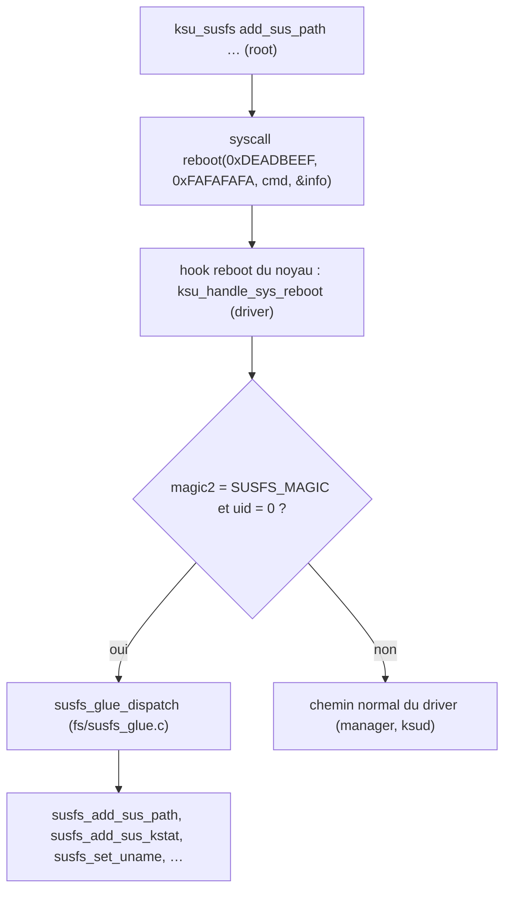

<div align="center">

# 🛡️ KernelSU-Next (legacy) + SuSFS 2.3.0
### pour le noyau **4.19** (non-GKI) du **Motorola One 5G Ace** (`kiev`)

*SuSFS n'est plus fourni pour les noyaux non-GKI : ce dépôt montre comment le brancher « à la main » sur KernelSU-Next, avec le script, les pièges rencontrés et les preuves de fonctionnement.*

`KernelSU-Next v3.4.0-legacy (33314-5)` · `SuSFS v2.3.0 (NON-GKI)` · `Linux 4.19.325` · `LineageOS 23.2` · `Android 16`

</div>

---

## 📖 Sommaire

1. [Résultat](#-résultat)
2. [Ce qui est vérifié, ce qui reste à valider](#-ce-qui-est-vérifié-ce-qui-reste-à-valider)
3. [⚠️ À lire avant de flasher](#️-à-lire-avant-de-flasher)
4. [Contenu de la release](#-contenu-de-la-release)
5. [Installation](#-installation)
6. [Utiliser SuSFS et le tester](#-utiliser-susfs-et-le-tester)
7. [Compiler soi-même (GitHub Actions)](#-compiler-soi-même-github-actions)
8. [Comment ça marche : la « colle » driver ↔ SuSFS](#-comment-ça-marche--la--colle--driver--susfs)
9. [🧗 Les difficultés rencontrées](#-les-difficultés-rencontrées)
10. [Limites connues](#-limites-connues)
11. [🩺 Dépannage](#-dépannage)
12. [Crédits](#-crédits)

---

## 🎯 Résultat

Relevé dans le manager KernelSU-Next, sur l'appareil :

| Élément | Valeur affichée |
|---|---|
| État | **En fonctionnement** (`BUILT-IN (GKI1)`) |
| Version du driver | `v3.4.0-legacy (33314-5)` |
| Version du manager | `v3.4.2-spoofed (33355-5)` |
| Méthode d'intégration | `Manual` |
| **SuSFS** | **`Supported | v2.3.0 (NON-GKI)`** |
| Méta-module | `OverlayFS MetaModule 1.3.1` |
| Zygisk | `Zygisk Next 1.5.2 (864-a4a72ce-release)` |
| SELinux | `Strict` |
| Seccomp status | `Disabled` (comportement attendu) |
| Super-utilisateurs / Modules | 3 / 9 |

<!-- Ajoute tes captures dans docs/ puis décommente : -->
<!--  -->
<!--  -->

Fonctions SuSFS compilées **et** confirmées par le noyau en fonctionnement (`ksu_susfs show enabled_features` et `ksud susfs features`) :

```text
CONFIG_KSU_SUSFS_SUS_PATH
CONFIG_KSU_SUSFS_SUS_MOUNT
CONFIG_KSU_SUSFS_SUS_KSTAT
CONFIG_KSU_SUSFS_SPOOF_UNAME
CONFIG_KSU_SUSFS_ENABLE_LOG
CONFIG_KSU_SUSFS_HIDE_KSU_SUSFS_SYMBOLS
CONFIG_KSU_SUSFS_SPOOF_CMDLINE_OR_BOOTCONFIG
CONFIG_KSU_SUSFS_OPEN_REDIRECT
CONFIG_KSU_SUSFS_SUS_MAP
CONFIG_KSU_SUSFS_PRIORITY_UID_FILTER
```

---

## ✅ Ce qui est vérifié, ce qui reste à valider

| Point | Statut | Preuve |
|---|---|---|
| SuSFS s'initialise au démarrage | ✅ | `dmesg` : `susfs is initialized! version: v2.3.0` à 0,79 s |
| Les commandes arrivent jusqu'au noyau | ✅ | `ksu_susfs show version` → `v2.3.0` |
| Les 10 options sont actives | ✅ | `ksu_susfs show enabled_features` |
| Le journal SuSFS fonctionne | ✅ | `ksu_susfs enable_log 1` → `ret: 0` dans `dmesg` |
| Tests d'intégrité / détection | ✅ *(à détailler)* | <!-- Indique ici les applications utilisées et les verdicts --> |
| Masquage d'un chemin (`SUS_PATH`) vu par une application **sans root** | ⬜ à valider | voir [le test](#test-1--masquer-un-fichier) |
| `SUS_MOUNT`, `OPEN_REDIRECT`, `SUS_KSTAT` en conditions réelles | ⬜ à valider | non testés individuellement |

> [!NOTE]
> Les verdicts Play Integrity dépendent surtout de ton module d'attestation (keybox, Tricky Store ou équivalent). SuSFS cache les traces de root (montages, chemins, `uname`, mappings) : ce sont les deux ensemble qui font passer les tests.

---

## ⚠️ À lire avant de flasher

> [!WARNING]
> **Flasher un noyau personnalisé peut empêcher le téléphone de démarrer.** Tu agis sous ta seule responsabilité. Aucune garantie n'est donnée.

- Le **bootloader doit être déverrouillé**.
- **Garde le `boot.img` d'origine** de *ta* version de ROM pour revenir en arrière.
- Cette image est construite pour **LineageOS 23.2, build du 20/09/2026** (noyau stock `4.19.325-cip136-st20-perf`). Sur un autre build, le risque de **kernel panic** augmente : la source du noyau et la ROM doivent dater du même moment.
- Teste **d'abord sans écrire** avec `fastboot boot`.
- Le bootloader peut refuser une image **plus ancienne** que celle déjà installée (anti-rollback).

---

## 📦 Contenu de la release

| Fichier | Rôle |
|---|---|
| `KernelSU-Next-SUSFS-<VER>-boot.img` | L'image à flasher : `boot.img` d'origine **repackée** avec le noyau, `ksud` et `su` |
| `Image-<VER>` | Le noyau brut |
| `System.map-<VER>` | Table des symboles (vérifier ce qui est compilé) |
| `audit-<VER>.txt` | Rapport du build : sonde des branches, contenu du driver, config finale, symboles |
| `ksud` | Le binaire `ksud` embarqué (compilé depuis le tag `v3.4.2`) |
| `susfs_patch_to_4.19.patch` | La copie **exacte** du patch SuSFS utilisé (à garder dans `patches/`) |
| `build_kernel.sh` | Le script de build complet |

`<VER>` vaut `ksun-susfs-probe2-official` pour le mode officiel décrit ici.

---

## 🚀 Installation

### 1. Tester sans écrire

```bash
adb reboot bootloader
fastboot boot KernelSU-Next-SUSFS-<VER>-boot.img
```

### 2. Flasher définitivement

```bash
fastboot getvar current-slot                # si ton appareil est en A/B
fastboot flash boot KernelSU-Next-SUSFS-<VER>-boot.img
fastboot reboot
```

### 3. Installer le bon manager

> [!IMPORTANT]
> Le driver est **épinglé sur un commit à protocole UAPI 5**. Utilise un manager de protocole 5 : **`v3.4.2-spoofed (33355-5)`** a été testé. Avec un driver plus récent (UAPI 6), le manager affiche *« manager version 5 is too low, upgrade to 6 or higher »* : c'est la raison de l'épinglage.

- Désinstalle l'ancien manager avant d'installer celui-ci.
- Un **méta-module** est nécessaire pour monter les modules (testé : *OverlayFS MetaModule 1.3.1*).

### 4. Revenir en arrière

```bash
fastboot flash boot boot-stock.img
```

---

## 🧪 Utiliser SuSFS et le tester

`ksud` sait parler à SuSFS (`ksud susfs …`). L'outil `ksu_susfs` est fourni par un module SuSFS 2.x (testé : *.BRENE - SuSFS*). Toutes ces commandes se lancent **en root** (`su`).

```bash
su -c "ksu_susfs show version"            # attendu : v2.3.0
su -c "ksu_susfs show enabled_features"   # liste des options actives
su -c "ksud susfs features"               # même liste via ksud
su -c "ksu_susfs enable_log 1"            # active les logs ; lire avec : dmesg | grep -i susfs
```

### Test 1 : masquer un fichier

> [!IMPORTANT]
> **Les applications qui ont accès au root ne sont pas masquées**, par conception : SuSFS cache les traces aux applications *ordinaires*. Un test depuis Termux avec root accordé ne prouve donc rien. Le noyau ne marque comme « démontées » que les applications sans accès su, au moment de leur lancement.

1. En root : `echo secret > /sdcard/Download/secret_test.txt` puis `ksu_susfs add_sus_path /sdcard/Download/secret_test.txt`.
2. Dans `dmesg`, cherche `flagged AS_FLAGS_SUS_PATH on pathname` : le noyau a marqué le fichier.
3. Ouvre une application **sans root** (un gestionnaire de fichiers) : le fichier doit avoir disparu du dossier.
4. Dans `dmesg`, une ligne `hiding path with ino …` confirme le masquage.

Si le fichier reste visible, vérifie dans le manager (onglet Superuser) que l'option de démontage des modules est active pour cette application.

### Test 2 : le spoof d'`uname`

```bash
su -c "ksu_susfs set_uname 4.19.999-test '#1 SMP test'"
uname -r                  # sans su : doit afficher la valeur spoofée
cat /proc/version         # peut garder l'ancienne valeur
```

---

## 🏗️ Compiler soi-même (GitHub Actions)

### Prérequis

1. Le `boot.img` **et** le `dtbo.img` d'origine de ta ROM (même date que celle installée) sur un lien Google Drive public. Renseigne leurs identifiants dans `BOOT_GDRIVE_ID` et `DTBO_GDRIVE_ID` en tête du script.
2. Un dépôt avec le script dans `scripts/build_kernel.sh` et les copies exactes du patch dans `patches/` (voir plus bas).

### Workflow d'exemple (à adapter)

```yaml
name: build-kernel
on: workflow_dispatch

jobs:
  build:
    runs-on: ubuntu-latest
    steps:
      - uses: actions/checkout@v4

      - name: Build
        run: bash scripts/build_kernel.sh
        env:
          KSUN_MODE: official        # voir le tableau des variables

      - uses: actions/upload-artifact@v4
        if: always()                  # publie même si une étape échoue
        with:
          name: kernel-output
          path: output/
```

> [!TIP]
> `if: always()` permet de récupérer `audit-<VER>.txt` et `build-errors.txt` même quand le build échoue.

### Les variables

| Variable | Défaut | Effet |
|---|---|---|
| `KSUN_MODE` | `official` | `official` : driver officiel épinglé + colle de ce script. `fork` : fork de sidex15 (non validé, voir [limites](#-limites-connues)) |
| `KSU_COMMIT` | `465490a` | Commit du driver (parent du commit « preinit » qui passe l'UAPI de 5 à 6) |
| `KSU_EXPECTED_UAPI` | `5` | Le script s'arrête si le driver n'a pas cette UAPI. Vide = seulement afficher |
| `KSUD_FALLBACK_REF` | `v3.4.2` | Tag utilisé pour `ksud` quand le commit épinglé n'a pas de dossier `userspace/ksud` |
| `KERNEL_PIN` | `9426323c2acd…` | Fige la **source du noyau** (branche `lineage-23.2`) sur un commit précis |
| `SUSFS_SUS_MOUNT`, `SUSFS_OPEN_REDIRECT`, `SUSFS_PRIORITY_UID_FILTER` | `1` | Active ces options. `0` pour les désactiver |
| `SUSFS_GLUE` | `1` | Ajoute la colle minimale `fs/susfs_glue.c` |
| `SUSFS_DISPATCH` | `1` | Câble les commandes `ksu_susfs` dans le driver |
| `SUSFS_MARK` | `1` | Marque les applications « démontées » dans le driver |
| `SUSFS_AUTOSTUB` | `1` | Génère des stubs pour des symboles `susfs_*` manquants à l'édition de liens |

### Le dossier `patches/` (build reproductible)

Mets-y la **copie exacte** de `susfs_patch_to_4.19.patch` (récupère-la dans les artefacts d'un build, ne la recopie pas à la main). Le script vérifie son intégrité (chaque bloc a la taille annoncée), affiche son `sha256`, puis l'applique à la place de la version de la branche `mainline`, qui change sans prévenir.

---

## 🔬 Comment ça marche : la « colle » driver ↔ SuSFS

Le driver KernelSU-Next *legacy* ne contient **aucun code SuSFS**. Le noyau reçoit SuSFS 2.3.0 par un patch (le fichier `fs/susfs.c` est entièrement créé par lui), puis ce script ajoute les trois morceaux qui relient le driver à SuSFS :



1. **Fichier `fs/susfs_glue.c`** : définitions *faibles* des symboles que SuSFS attend du driver (`setup_selinux`, `ksu_cred`, `susfs_ksu_sid`, `susfs_is_current_ksu_domain`…). Si le driver en fournit un, c'est le sien qui gagne. Il appelle aussi `susfs_init()` au démarrage.
2. **Aiguillage des commandes** : un court bloc injecté dans `ksu_handle_sys_reboot` (`supercall/supercall.c`) reconnaît la magie SuSFS (`0xFAFAFAFA`), vérifie que l'appelant est root, et transmet à la colle.
3. **Marquage des processus** : dans `ksu_handle_setresuid` (`hook/setuid_hook.c`), les applications sans accès su sont marquées « démontées » (`susfs_set_current_proc_umounted()`). Sans ce drapeau, `SUS_PATH`, `SUS_KSTAT` et `SUS_MOUNT` ne masquent rien.

Les hooks du noyau restent ceux du script KernelSU-Next d'origine : **hooks manuels** (`execveat`, `faccessat`, `read`, `stat`, `reboot`) plus le *backport* de `path_umount`. Le script de hooks « inline » de Jack **n'est pas utilisé**.

---

## 🧗 Les difficultés rencontrées

| Symptôme | Cause | Solution |
|---|---|---|
| Édition de liens : `susfs_is_current_ksu_domain`, `susfs_ksu_sid`, `susfs_priv_app_sid` non définis | Le driver legacy n'a aucun code SuSFS | Colle `fs/susfs_glue.c` à définitions faibles |
| Le manager affiche *« manager version 5 is too low »* | Un commit récent du driver (« preinit ») fait passer l'UAPI de 5 à 6 | Épingler le driver sur le commit parent (`465490a`) et compiler `ksud` depuis le tag `v3.4.2` |
| Le build compilait hier, plus aujourd'hui (`unknown warning option '-Wno-cast-function-type-strict'`) | La branche `lineage-23.2` a avancé ; le clang du runner est trop ancien | Épingler la source (`KERNEL_PIN`), garde-fou clang |
| `fs/susfs.c` absent après le patch, ou bloc `#ifdef` jamais fermé | Copie du patch incomplète ; ancienne version du patch défectueuse | Copie exacte dans `patches/`, contrôle d'intégrité, correction du `#endif` |
| Le driver n'a pas d'options `KSU_SUSFS_*` | Kconfig absent | Kconfig injecté par le script (`fs/Kconfig.susfs_inject`) |
| `ksu_susfs` répond mais rien n'est câblé | Aucune commande SuSFS dans `ksu_handle_sys_reboot` | Aiguillage injecté (magie `0xFAFAFAFA`) |
| Un fichier « masqué » reste visible depuis Termux | Termux a accès root : jamais masqué par conception | Tester avec une application sans root |
| Variante fork (sidex15) : `susfs_add_try_umount` puis `susfs_try_umount` indéfinis | Fonctions retirées de SuSFS 2.x que le fork appelle encore | Stubs faibles sans effet, boucle d'auto-stub |

### Ce qui a aidé

- **Lire le vrai code du driver** (`audit-<VER>.txt`) avant de câbler quoi que ce soit : le script écrit lui-même ces informations.
- **Tout épingler** : source du noyau, driver, patch SuSFS. Chaque entrée qui bouge peut casser un build qui marchait.
- **`make -k`** et un fichier `build-errors.txt` : toutes les erreurs d'un coup au lieu d'une par exécution.
- **La sonde de branches** (`git ls-remote`) pour repérer qu'un fork avait déjà une branche SuSFS.

---

## 🚧 Limites connues

- **Masquage non validé de bout en bout** : `SUS_PATH`, `SUS_MOUNT`, `OPEN_REDIRECT` et `SUS_KSTAT` sont compilés et pilotables, mais seul l'état « actif » est démontré ici (voir le tableau de vérification).
- **Marquage approximatif** : une application est marquée « démontée » quand elle n'a pas accès su ; ça suit la règle du driver sur les profils d'applications.
- **Variante `fork`** : la branche `legacy-susfs-v2` de sidex15 compile, mais l'édition de liens a échoué sur `susfs_try_umount` ; le correctif (stub) est écrit mais **non testé sur l'appareil**.
- **Dépendance à la ROM** : validé sur LineageOS 23.2 du **20/09/2026**.
- **Version du noyau affichée** : le manager montre `4.19.325-g29562686`, différente du build sans SuSFS. Le noyau inclut le spoof d'`uname` de SuSFS : un module peut donc modifier la valeur affichée ; vérifie avec `cat /proc/version`.
- **Pas de test automatisé** des hooks : seule la présence des symboles et le comportement observé sur l'appareil servent de preuve.

---

## 🩺 Dépannage

<details>
<summary><b>Le manager n'affiche pas « SuSFS version »</b></summary>

- Vérifie que tu as flashé la bonne image (`dmesg | grep susfs` doit montrer `susfs is initialized`).
- Si rien n'apparaît, le build n'a pas inclus la colle : relis `audit-<VER>.txt` (section `colle minimale ajoutée`).
</details>

<details>
<summary><b>« manager version 5 is too low »</b></summary>

Le driver n'est pas celui épinglé. Vérifie `KSU_COMMIT` et la ligne `UAPI du driver : 5` dans le log du build.
</details>

<details>
<summary><b>Le build échoue</b></summary>

1. `bash -n scripts/build_kernel.sh` : une ligne tronquée est la cause la plus fréquente.
2. Télécharge `build-errors.txt` et `audit-<VER>.txt` (pense à `if: always()`).
3. Vérifie la ligne `sha256 patch SuSFS` : elle doit être identique d'un build à l'autre.
</details>

<details>
<summary><b>Le téléphone ne démarre plus</b></summary>

Reflash le `boot.img` d'origine de ta ROM et vérifie que sa date correspond à celle de l'image.
</details>

---

## 🙏 Crédits

- **[KernelSU-Next](https://github.com/KernelSU-Next/KernelSU-Next)** et ses contributeurs (branche *legacy*)
- **SuSFS** — simonpunk et contributeurs
- **[JackA1ltman/NonGKI_Kernel_Build_2nd](https://github.com/JackA1ltman/NonGKI_Kernel_Build_2nd)** — patch SuSFS pour 4.19
- **sidex15** — fork de KernelSU-Next avec branches SuSFS (variante explorée)
- **[LineageOS](https://lineageos.org/)** — sources du noyau `android_kernel_motorola_sm8250`
- **[Magisk](https://github.com/topjohnwu/Magisk)** — `magiskboot` pour le repack

## 📜 Licence

Le noyau Linux et le driver KernelSU-Next sont sous **GPL-2.0**. Le script et la documentation sont fournis **sans garantie**, à titre d'information.

<div align="center">

*Si ce dépôt t'a fait gagner du temps, laisse une ⭐ — et si tu valides le masquage de bout en bout, ouvre une issue pour partager ton résultat !*

</div>
