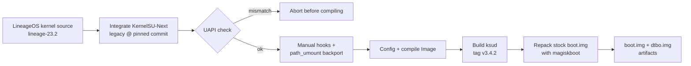

# KernelSU-Next for Motorola One 5G Ace (kiev)

Custom **4.19 kernel with KernelSU-Next root** for the **Motorola One 5G Ace (`kiev`, SM8250)** running **LineageOS 23.2 (Android 16)**, built entirely on GitHub Actions.

-blue)


-orange)


> [!WARNING]
> Flashing a custom kernel can leave your device unbootable. Back up your stock `boot.img` and `dtbo.img` first, and only continue if you know how to recover with `fastboot`. You are responsible for your own device.

---

## Table of contents

- [Highlights](#highlights)
- [Status](#status)
- [Version compatibility (read this first)](#version-compatibility-read-this-first)
- [How it is built](#how-it-is-built)
- [Build it yourself](#build-it-yourself)
- [Flashing](#flashing)
- [Verifying the install](#verifying-the-install)
- [Troubleshooting](#troubleshooting)
- [Not included](#not-included)
- [Roadmap](#roadmap)
- [Credits](#credits)
- [License](#license)

---

## Highlights

- **Root through KernelSU-Next**, built into the kernel (`legacy` branch, made for non-GKI kernels).
- **Manual hooks**: no kprobes dependency, hooks applied to the kernel source by script.
- **Touchscreen works** with the stock Motorola touch modules on LineageOS 2026-09-20.
- **Reproducible**: the driver is pinned to an exact commit and the script aborts *before* compiling if the driver's UAPI version does not match the manager you intend to use.
- **No manual repacking**: the workflow downloads your stock `boot.img`, swaps in the new kernel and injects `ksud` with `magiskboot`.

## Status

| Item | State |
| --- | --- |
| Boot on LineageOS 23.2 (build 2026-09-20) | Works |
| Touchscreen | Works |
| Manager detects the kernel (no warning banner) | Works |
| Root grants / Superuser list | Works |
| Modules (Zygisk Next, LSPosed, Play Integrity Fix, TEESimulator-RS, Specter, VBMeta Fixer, HMA-OSS, Auto Target) | Loaded and enabled in the manager |
| SuSFS in the kernel | Not included |
| Metamodule | Not installed (not needed for the modules above to show as enabled) |

Tested with manager **v3.4.2 (spoofed variant)**, which shows the kernel as `v3.4.0-legacy (33314-5)`.

## Version compatibility (read this first)

The manager and the kernel driver talk through a versioned interface (**UAPI**). The number after the dash in the manager (for example `33314-5`) is that UAPI version. If the manager's UAPI is lower than the driver's, the manager shows a red banner and hides root management.

| Component | Version | UAPI |
| --- | --- | :---: |
| Kernel driver | KernelSU-Next `legacy` at commit `465490a` | 5 |
| `ksud` (userspace daemon) | KernelSU-Next tag `v3.4.2` | 5 |
| Manager | v3.4.2 | 5 |
| Kernel driver, `legacy` at `0b17f24` or later | adds module preinit | **6**, rejected by manager v3.4.2 |

Why not just track `legacy`?

- `legacy` moves fast. At `0b17f24` ("Add module preinit") the UAPI went from 5 to 6, and the manager stable release was still on 5.
- The `legacy` branch only contains `kernel/` and `uapi/`. There is **no manager and no `ksud` source** in it, so both come from the main line at tag `v3.4.2`.
- A `ksud` built from a different line than the driver can speak a different protocol, so this project builds it from the same release as the manager.

When a manager with UAPI 6 is available and you want to move forward, change the three variables below together, not one at a time.

## How it is built



What the script does, in short:

1. Clones `LineageOS/android_kernel_motorola_sm8250` (`lineage-23.2`).
2. Integrates KernelSU-Next with its `setup.sh`, then pins the driver to `KSU_COMMIT`.
3. Reads `KERNEL_SU_UAPI_VERSION` from the pinned driver and stops if it differs from `KSU_EXPECTED_UAPI`.
4. Applies manual hooks (`execveat`, `faccessat`, `read`, `stat`, `reboot`) and backports `path_umount` for 4.19.
5. Enables `CONFIG_KSU` with `CONFIG_KSU_MANUAL_HOOK` and no SuSFS, and applies the Motorola touchscreen compatibility stub.
6. Compiles the kernel `Image` with LLVM.
7. Builds `ksud` for `aarch64-linux-android` with NDK r26d.
8. Unpacks your stock `boot.img`, replaces the kernel, adds `ksud` and a `su` entry to the ramdisk, and repacks.
9. Prints diagnostics: pinned driver commit, UAPI value, kernel hash check, `ksud` presence in the ramdisk.

## Build it yourself

1. Fork this repository (`https://github.com/<your-username>/KernelSU-Next-SUSFS-kiev`).
2. Upload your **stock `boot.img` and `dtbo.img` from the exact LineageOS build installed on your phone**, then set `BOOT_GDRIVE_ID` and `DTBO_GDRIVE_ID` at the top of `build_ksun_legacy_v2.9.sh` to your own file IDs.
3. Run the workflow from the **Actions** tab.
4. Download the artifacts: `KernelSU-Next-NoSUSFS-v2.9-boot.img`, `dtbo.img`, `ksud` and `build.log`.

### Configuration variables

Set them as environment variables of the workflow step, or edit the defaults in the script.

| Variable | Default | Purpose |
| --- | --- | --- |
| `KSU_REF` | `legacy` | Branch or tag passed to KernelSU-Next's `setup.sh` |
| `KSU_COMMIT` | `465490a` | Exact driver commit to check out after integration |
| `KSU_EXPECTED_UAPI` | `5` | UAPI the manager supports; the build aborts if the driver differs |
| `KSUD_FALLBACK_REF` | `v3.4.2` | Tag used to build `ksud` (the `legacy` branch has no userspace) |

> [!IMPORTANT]
> The kernel source date must match the ROM installed on the device. A kernel built from an older source than your ROM can panic at boot, and modules from a different build are rejected with `disagrees about version of symbol module_layout`.

## Flashing

> [!CAUTION]
> Use a `boot.img` and `dtbo.img` taken from the **same ROM build** as the one installed. Images from an older ROM build may be rejected by the bootloader (rollback protection).

1. Back up your current boot partition (or keep the stock `boot.img` from your ROM zip).
2. Reboot to the bootloader and flash:

   ```bash
   adb reboot bootloader
   fastboot flash boot KernelSU-Next-NoSUSFS-v2.9-boot.img
   fastboot flash dtbo dtbo.img
   fastboot reboot
   ```

3. Install the **KernelSU-Next manager v3.4.2** APK and keep it on that version while you use this driver.

To go back to stock, flash your original `boot.img` and `dtbo.img` the same way.

## Verifying the install

Open the manager. A healthy install looks like this:

- Home shows **"Working"** with a version such as `v3.4.0-legacy (33314-5)`.
- The suffix after the dash equals the manager's own suffix (`-5`).
- **Integration method** is `Manual`.
- No red banner; the **Superuser** tab is available.

From Termux you can also check root:

```bash
su -c id
```

You should see `uid=0(root)`.

## Troubleshooting

| Symptom | Likely cause | What to do |
| --- | --- | --- |
| Red banner: *"manager version 5 is too low … version 6 or higher"* | Driver is newer (UAPI 6) than the manager (UAPI 5) | Rebuild with `KSU_COMMIT=465490a`, or use a manager with UAPI 6 |
| Superuser tab missing | Same mismatch, the manager refuses to manage root | Same as above |
| No touchscreen | Kernel does not match the ROM build, or the touch stub was removed | Rebuild from the source matching your ROM date and keep the stub |
| Bootloop or panic right after flashing | Wrong `boot.img` base or mismatched ROM build | Flash your stock `boot.img` back, then rebuild with the images of the installed ROM |
| Build stops with "UAPI du driver … différente de celle attendue" | Pinned driver does not match `KSU_EXPECTED_UAPI` | Check the commit; this is the safeguard working as intended |
| `userspace/ksud absent` warning in the log | Expected: `legacy` has no userspace | Nothing, `ksud` is built from the fallback tag |
| SuSFS module says "Active" | Stale description from an earlier kernel | The kernel has no SuSFS, see below |

## Not included

- **SuSFS**: not compiled into the kernel. SuSFS modules for the manager will not hide anything without kernel support, even if their description says otherwise.
- **Kernel-level hiding or spoofing features** beyond what KernelSU-Next provides.
- **OTA survival**: after a LineageOS update, rebuild with the new ROM's images and source.

## Roadmap

Ideas, in the order they are likely to be tried. One feature per build, so a touchscreen regression can be traced to a single change.

- [ ] **BBR** TCP congestion control (config only)
- [ ] **Droidspaces** support (namespaces, cgroups and related options)
- [ ] **ReKernel** (small source patch, useful with app freezers)
- [ ] **Baseband-guard** (LSM, integration on 4.19 to be evaluated)
- [ ] Move to a manager and driver pair on UAPI 6 once a matching manager is released

## Credits

- [KernelSU-Next](https://github.com/KernelSU-Next/KernelSU-Next) team and the upstream KernelSU project
- [LineageOS](https://lineageos.org/) and its Motorola SM8250 kernel maintainers
- [backslashxx](https://github.com/backslashxx) for the `magiskboot cpio` repack approach used here
- [Magisk](https://github.com/topjohnwu/Magisk) for `magiskboot`

## License

The Linux kernel and the KernelSU-Next kernel module are licensed under **GPL-2.0**. Add a `LICENSE` file here for the build scripts and workflow of this repository.

---

*Not affiliated with Motorola, LineageOS or the KernelSU-Next project.*
